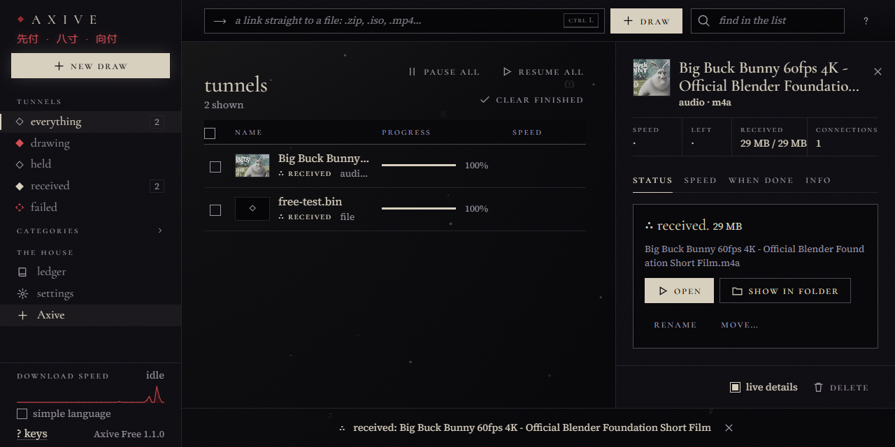
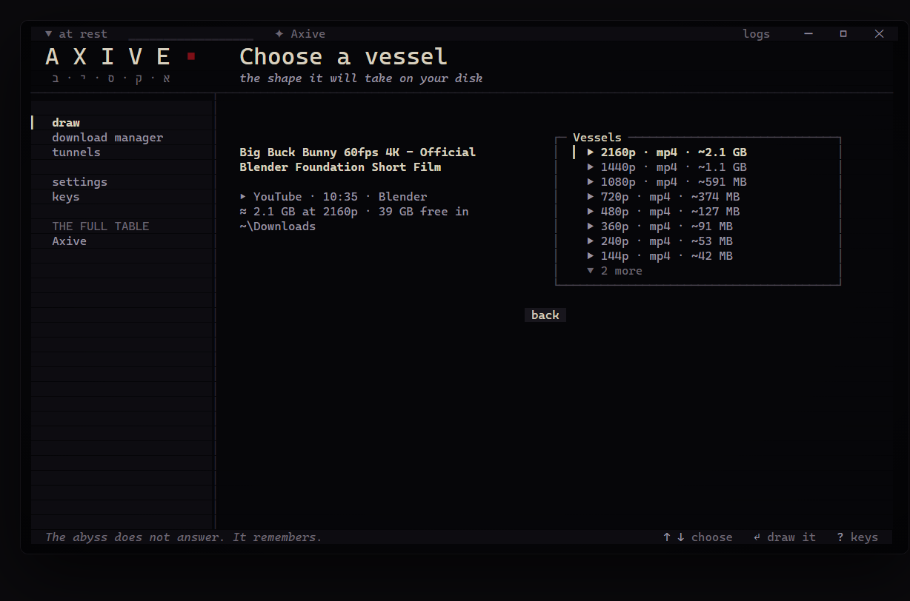
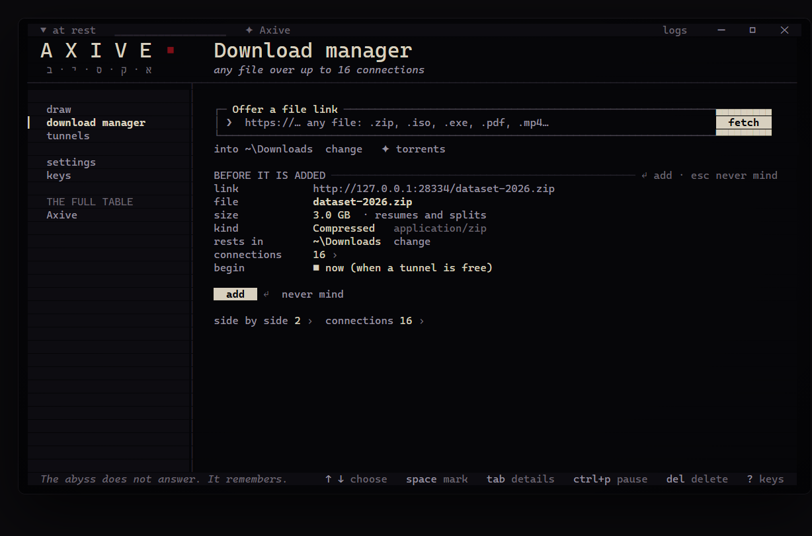
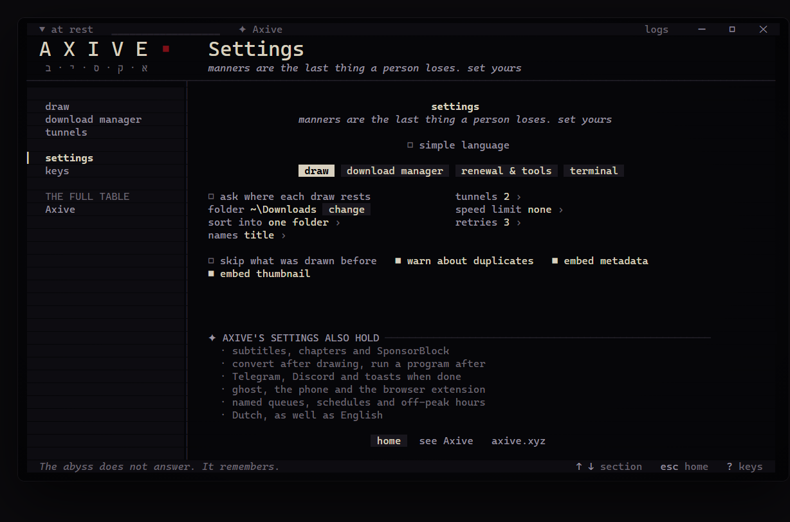
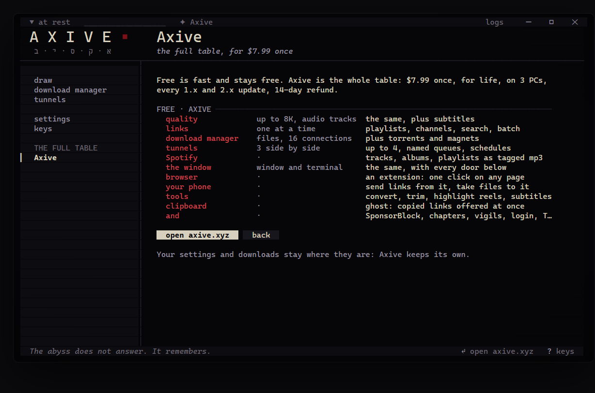

<div align="center">


# Axive Free

### A free, open-source video downloader and download manager for Windows

Paste a link and it lands on your disk.<br>
Video and music from **1,800+ sites** up to **8K**, in a **window** or in the **terminal**, and a **16-connection download manager** for any file.<br>
One `.exe`, no installer, no account, no ads, no telemetry. GPL-3.0.

[**Download Axive Free for Windows**](https://github.com/AxiveCuisine/axive-free/releases/latest) &nbsp;·&nbsp; [Free or Axive?](#free-or-axive) &nbsp;·&nbsp; [The full Axive](https://axive.xyz/?ref=github)



<sub>In the picture: <i>Big Buck Bunny</i> © Blender Foundation, CC BY 3.0.</sub>

</div>

## What it does

| | |
|---|---|
| **Video and music** | YouTube, TikTok, X, Instagram, Reddit, Vimeo, SoundCloud, Bandcamp, Twitch clips and [1,800+ more sites](https://github.com/yt-dlp/yt-dlp/blob/master/supportedsites.md), one link at a time. Every quality the site offers (up to 8K), or MP3 / M4A audio. |
| **The audio track you want** | A YouTube video with dubbed or described audio shows its languages, original first. Axive Free draws the one you chose or says it is gone; it never swaps in another. |
| **Download manager** | Any file link (`.zip`, `.iso`, `.exe`, `.pdf`, `.mp4`...): size and resume support shown before it starts, up to 16 connections, pause, resume (also after closing the app), a fresh link for an expired one, a checksum when it is done, and a folder per file type if you like. |
| **Three at once** | Up to three downloads side by side, each at full speed. |
| **Window or terminal** | The same downloads, list and settings in both. Double-click the exe for the window; type `Axive-Free.exe` in a terminal for the terminal. Open the other one and Axive Free moves there, carrying what is downloading. |
| **The ledger** | What you downloaded, with its folder. It also warns before you take the same video twice. Deleting a row can send the file to the Recycle Bin too. |
| **Tags and covers** | Title, artist, date and cover art written into the file. |
| **Keeps itself working** | Sites change; one button renews yt-dlp (checked against its published checksum). Every bundled tool is hashed at each launch and restored from the exe if it was damaged. |
| **Simple language** | Axive speaks in its own literary voice ("draw", "vessel", "tunnel"). One switch puts every word in plain everyday English. |

## How the speed works

Most downloaders pull a file through one connection. Axive Free uses the tools built for doing better:

- **16 connections per file** through [aria2](https://aria2.github.io). On a line where one stream gives 9 MB/s, sixteen filled it at 25 MB/s in our test.
- **8 fragments at once for video** through [yt-dlp](https://github.com/yt-dlp/yt-dlp).
- **It steps down instead of failing.** A server that refuses 16 connections is met with 4, then 2, then 1.
- **A direct link to an `.mp4`, `.mkv` or `.mp3`** takes the 16-connection path instead of a single stream.

<table>
<tr>
<td width="50%"><br><sub>The terminal: choose a vessel, every quality the site offers or audio only.</sub></td>
<td width="50%"><br><sub>The download manager: one file, sixteen connections.</sub></td>
</tr>
<tr>
<td width="50%"><br><sub>Settings: folders, names, speed limit, connections.</sub></td>
<td width="50%"><br><sub>What the full Axive adds, inside the app.</sub></td>
</tr>
</table>

## Get started

1. Download **`Axive-Free.exe`** from the [latest release](https://github.com/AxiveCuisine/axive-free/releases/latest).
2. Double-click it. The first launch unpacks the tools it carries and checks each one (a few seconds, longer while an antivirus looks at them), then opens the window.
3. Paste a link (or drop one on the window) and press Enter.

Windows 10 or 11, 64-bit. The exe is about 225 MB; with its tools unpacked it takes about 550 MB on disk. Nothing else to install: yt-dlp, FFmpeg and aria2 travel inside the exe. The window uses Microsoft Edge WebView2, which Windows 10 and 11 already have; without it, the window opens in Edge instead.

> **SmartScreen.** The exe is not code-signed, so Windows may say it "protected your PC" the first time. Choose **More info › Run anyway**. Every release lists the SHA-256 of its exe, so you can check that the file you have is the one published there: `Get-FileHash .\Axive-Free.exe` in PowerShell.

From PowerShell:

```powershell
.\Axive-Free.exe                                        # the terminal
.\Axive-Free.exe --gui                                  # the window
.\Axive-Free.exe https://www.youtube.com/watch?v=...    # straight to the qualities for that link
.\Axive-Free.exe config set tunnels 1                   # any setting, from the command line
.\Axive-Free.exe --help
```

**Coming from Axive Free 1.0?** Your settings, ledger and unfinished downloads stay where they were (`%LOCALAPPDATA%\Axive Free`). The 1080p cap is gone, and up to three downloads run at once.

## Free or Axive?

Axive Free is complete for downloading one link at a time, at any quality, plus fast file downloads. It stays free, and fixes reach it too.

**[Axive](https://axive.xyz/?ref=github)** adds automation, bulk and the extra conveniences, for people who download a lot. **$7.99 once**, for life, on 3 PCs, with every 1.x and 2.x update and a 14-day refund.

| | **Axive Free** | **Axive** |
|---|:---:|:---:|
| Video and music from 1,800+ sites, up to 8K | ✓ | ✓ |
| Choice of audio track | ✓ | ✓ |
| Window and terminal | ✓ | ✓ |
| Download manager, 16 connections per file, pause and resume | ✓ | ✓ |
| Downloads side by side | 3 | up to 4 |
| Ledger, delete to the Recycle Bin, tool check and repair | ✓ | ✓ |
| **Playlists and whole channels** | | ✓ |
| **Search YouTube, batch many links, a .txt list** | | ✓ |
| **Spotify** links and your own library, as tagged MP3 | | ✓ |
| **Torrents and magnet links** | | ✓ |
| **Browser extension** for Chrome, Edge, Brave and Firefox | | ✓ |
| **Your phone** as a remote, and taking finished files to it | | ✓ |
| **Ghost**: a link you copy anywhere is offered at once | | ✓ |
| Convert, trim, highlight reels, subtitles and transcripts | | ✓ |
| SponsorBlock, chapters, choosing the thumbnail | | ✓ |
| Sign in for age-gated, members-only and private videos | | ✓ |
| Named queues, schedules, a speed limit per download | | ✓ |
| Vigils: watch channels, download only what is new | | ✓ |
| Notifications: Windows, Telegram, Discord | | ✓ |
| English and Dutch | English | ✓ |
| Price | free | **$7.99 once** |

Free and Axive keep separate settings and folders, so both can sit on the same PC. Where Free meets something only Axive does (a playlist, a torrent, a Spotify link), it says so in one line and goes on.

## Keys

In the terminal every action is also a button you can click.

| | |
|---|---|
| `Enter` | draw the link in the box |
| `Ctrl+V` or right-click | paste |
| `Ctrl+D` | the download manager |
| `Ctrl+N` | a new link |
| `Ctrl+P` / `Ctrl+R` | pause / resume |
| `Ctrl+L` | the log drawer (raw yt-dlp and FFmpeg output) |
| `Esc` | back |
| `?` | every key, in the terminal and in the window |

## Privacy

Axive Free has no account, no telemetry and no ads. It talks to the sites you give it links to and, if "check for renewal" is on, to GitHub once a day to see whether yt-dlp or Axive Free has a newer release. The window is served only to this PC (127.0.0.1, with a key per launch). Logs stay on your PC and are scrubbed of your user name and home folder.

## Use it fairly

Download what you have the right to download: your own uploads, public domain and Creative Commons work, or what a site's terms allow. Axive Free does not break DRM or copy protection.

## Build from source

Node.js 22 or newer, on Windows.

```powershell
npm install
npm test               # unit tests
npm run typecheck
npm run build          # the window's page, then dist\axive.mjs and dist\axive.cjs
.\scripts\package.ps1  # release\Axive-Free.exe with yt-dlp, FFmpeg, aria2, Node and the window inside
```

`package.ps1` downloads yt-dlp and checks it against its published SHA2-256SUMS, pins aria2 1.37.0 by hash, fetches an FFmpeg build from yt-dlp/FFmpeg-Builds, and compiles the small native helper and the window with the C# compiler that ships with Windows (the WebView2 SDK is pinned by hash and its Microsoft signature is checked). `tools\exe-ui-test\click.mjs` drives the packaged exe in a pseudo-terminal and clicks through every screen.

Run it without packaging: `node dist\axive.mjs` with `AXIVE_BIN` pointing at a folder holding `yt-dlp\yt-dlp.exe`, `ffmpeg\ffmpeg.exe` and `aria2\aria2c.exe`.

## Licence

Axive Free is free software under the [GNU General Public License v3.0](LICENSE).

It carries independent programs under their own licences: [yt-dlp](https://github.com/yt-dlp/yt-dlp) (Unlicense), [FFmpeg](https://ffmpeg.org) (GPL v3), [aria2](https://aria2.github.io) (GPL v2 or later), [Node.js](https://nodejs.org) (MIT), [Ink](https://github.com/vadimdemedes/ink), React and React DOM (MIT), Microsoft Edge WebView2 SDK (BSD-style), and the Cormorant and Source Serif 4 fonts (SIL Open Font License). See [THIRD-PARTY-NOTICES.txt](THIRD-PARTY-NOTICES.txt), or run `Axive-Free.exe --notices`.

Found a bug? [Report it here](https://github.com/AxiveCuisine/axive-free/issues/new/choose) with the form. Every report is read, but there is no promise of a reply or of a date for a fix. Pull requests are not merged. Questions about buying Axive belong on [axive.xyz](https://axive.xyz/?ref=github).
