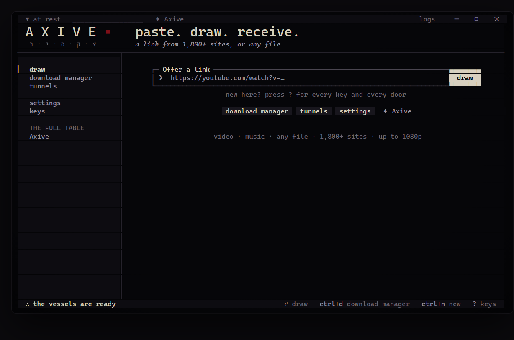

<div align="center">


# Axive Free

### The fastest free video and file downloader for Windows

Paste a link. Press Enter. It lands on your disk.<br>
Video and music from **1,800+ sites** up to **1080p**, and a **16-connection download manager** for any file.<br>
One `.exe`, no installer, no account, no ads, no telemetry.

[**Download Axive Free for Windows**](https://github.com/AxiveCuisine/axive-free/releases/latest) &nbsp;·&nbsp; [Get the full Axive](https://axive.xyz/?ref=github) &nbsp;·&nbsp; [What Axive adds](#free-or-axive)



</div>

## Why it is fast

Most downloaders pull a file through one connection. Axive Free does not.

- **16 connections per file.** The download manager splits every file into up to 16 parallel streams (aria2 underneath). On a line where one stream gives 9 MB/s, sixteen fill it at 25 MB/s.
- **8 fragments at once for video.** Streaming sites send video in small pieces: Axive Free asks for eight at a time (yt-dlp underneath).
- **It adapts.** A server that refuses that many connections is met with 4, then 2, then 1, and Axive Free climbs back up once the server allows it again. Nothing fails just because a server is strict.
- **Video files go the fast way too.** A link straight to an `.mp4`, `.mkv` or `.mp3` takes the 16-connection path instead of a single stream.
- **Two downloads side by side,** each at full speed, with pause and resume that survives closing the app.

## What it does

| | |
|---|---|
| **Video and music** | YouTube, TikTok, X, Instagram, Reddit, Vimeo, SoundCloud, Bandcamp, Twitch clips and [1,800+ more sites](https://github.com/yt-dlp/yt-dlp/blob/master/supportedsites.md). Choose the quality (up to 1080p) or MP3 / M4A audio. |
| **Download manager** | Any file link (`.zip`, `.iso`, `.exe`, `.pdf`, `.mp4`...): its size and resume support are shown before it starts, then up to 16 connections, pause, resume, a fresh link for an expired one, and (if you like) a folder per file type. |
| **Tags and covers** | Title, artist, date and cover art written into the file. |
| **No duplicates** | It remembers what you downloaded and says so before you take the same video twice. |
| **Keeps itself working** | Sites change; one button renews yt-dlp (checked against its published checksum). Every bundled tool is verified by hash at launch and repaired if damaged. |
| **Simple language** | Axive speaks in its own literary voice ("draw", "vessel", "tunnel"). One switch turns every word into plain everyday English. |
| **Mouse and keyboard** | Every action is a button you can click, and every screen has keys. Press `?` anywhere for all of them. |

<table>
<tr>
<td width="50%"><br><sub>Choose a vessel: every quality up to 1080p, or audio only.</sub></td>
<td width="50%"><br><sub>The download manager: one file, sixteen connections.</sub></td>
</tr>
<tr>
<td width="50%"><br><sub>Settings: folders, names, speed limit, connections.</sub></td>
<td width="50%"><br><sub>What the full Axive adds, inside the app.</sub></td>
</tr>
</table>

## Get started

1. Download **`Axive-Free.exe`** from the [latest release](https://github.com/AxiveCuisine/axive-free/releases/latest).
2. Double-click it. The first launch unpacks its tools (about 20 seconds) and opens in its own Windows Terminal window.
3. Paste a link and press Enter.

Windows 10 or 11 (64-bit). Windows Terminal is used when it is there (it comes with Windows 11); otherwise Axive Free runs in the classic console. Nothing else to install: yt-dlp, FFmpeg and aria2 travel inside the exe.

> **SmartScreen.** The exe is not code-signed, so Windows may say it "protected your PC" the first time. Choose **More info › Run anyway**. Every release lists the SHA-256 of the exe so you can check it is the file built here.

It also works from PowerShell:

```powershell
.\Axive-Free.exe https://www.youtube.com/watch?v=...   # straight to the qualities for that link
.\Axive-Free.exe config set tunnels 1                   # any setting, from the command line
.\Axive-Free.exe --help
```

## Free or Axive?

Axive Free is complete for one link at a time, up to 1080p, plus fast file downloads. It stays free.

**[Axive](https://axive.xyz/?ref=github)** is the full table, for people who download a lot. **$7.99 once**, for life, on 3 PCs, with every 1.x and 2.x update and a 14-day refund.

| | **Axive Free** | **Axive** |
|---|:---:|:---:|
| Video and music from 1,800+ sites | ✓ | ✓ |
| Quality | up to 1080p | **up to 8K** (1440p, 4K, 8K) |
| Download manager, 16 connections per file | ✓ | ✓ |
| Downloads side by side | 2 | up to 4 |
| **Playlists and whole channels** | | ✓ |
| **Search YouTube, batch many links, a .txt list** | | ✓ |
| **Spotify** tracks, albums and playlists as tagged MP3 | | ✓ |
| **Torrents and magnet links** | | ✓ |
| **The window**: a full graphical app beside the terminal | | ✓ |
| **Browser extension**: one click on any page (Chrome, Edge, Brave) | | ✓ |
| **Your phone**: send links from it, take finished files to it | | ✓ |
| **Ghost**: a link you copy anywhere is offered at once | | ✓ |
| Convert, trim, highlight reels, subtitles and transcripts | | ✓ |
| SponsorBlock, chapters, choosing the thumbnail | | ✓ |
| Sign in for age-gated, members-only and private videos | | ✓ |
| Named queues, schedules, off-peak hours, per-site rules | | ✓ |
| Vigils: watch channels, download only what is new | | ✓ |
| Notifications: Windows, Telegram, Discord | | ✓ |
| A searchable ledger of everything downloaded | | ✓ |
| English and Dutch | English | ✓ |
| Price | free | **$7.99 once** |

Free and Axive keep separate settings and folders, so both can sit on the same PC. Wherever Free meets something only Axive does (a playlist, a torrent, a Spotify link, a 4K video), it says so plainly and stays out of your way.

<div align="center">

[**See everything Axive does at axive.xyz**](https://axive.xyz/?ref=github)

</div>

## Keys

| | |
|---|---|
| `Enter` | draw the link in the box |
| `Ctrl+V` or right-click | paste |
| `Ctrl+D` | the download manager |
| `Ctrl+N` | a new link |
| `Ctrl+P` / `Ctrl+R` | pause / resume |
| `Ctrl+L` | the log drawer (raw yt-dlp and FFmpeg output) |
| `Esc` | back |
| `?` | every key, on every screen |

## Privacy

Axive Free has no account, no telemetry and no ads. It talks to the sites you give it links to, and (if "check for renewal" is on) to GitHub, once a day, to see whether yt-dlp or Axive Free has a newer release. Logs stay on your PC and are scrubbed of your user name and home folder. Settings live in `%LOCALAPPDATA%\Axive Free`.

## Use it fairly

Download what you have the right to download: your own uploads, public domain and Creative Commons work, or what a site's terms allow. Axive Free does not break DRM or copy protection.

## Build from source

Node.js 22 or newer, on Windows.

```powershell
npm install
npm test            # unit tests
npm run typecheck
npm run build       # dist\axive.mjs and dist\axive.cjs
.\scripts\package.ps1   # release\Axive-Free.exe with yt-dlp, FFmpeg, aria2 and Node inside
```

`package.ps1` downloads yt-dlp and checks it against its published SHA2-256SUMS, pins aria2 1.37.0 by hash, fetches an FFmpeg build from yt-dlp/FFmpeg-Builds, and compiles the small native helper with the C# compiler that ships with Windows. `tools\exe-ui-test\click.mjs` drives the packaged exe in a pseudo-terminal and clicks through every screen.

Run it without packaging: `node dist\axive.mjs` with `AXIVE_BIN` pointing at a folder holding `yt-dlp\yt-dlp.exe`, `ffmpeg\ffmpeg.exe` and `aria2\aria2c.exe`.

## Licence

Axive Free is free software under the [GNU General Public License v3.0](LICENSE).

It carries independent programs under their own licences: [yt-dlp](https://github.com/yt-dlp/yt-dlp) (Unlicense), [FFmpeg](https://ffmpeg.org) (GPL v3), [aria2](https://aria2.github.io) (GPL v2 or later), [Node.js](https://nodejs.org) (MIT), [Ink](https://github.com/vadimdemedes/ink) and React (MIT). See [THIRD-PARTY-NOTICES.txt](THIRD-PARTY-NOTICES.txt), or run `Axive-Free.exe --notices`.

This repository is published as is: it does not take issues or pull requests. Axive and its support live at [axive.xyz](https://axive.xyz/?ref=github).
